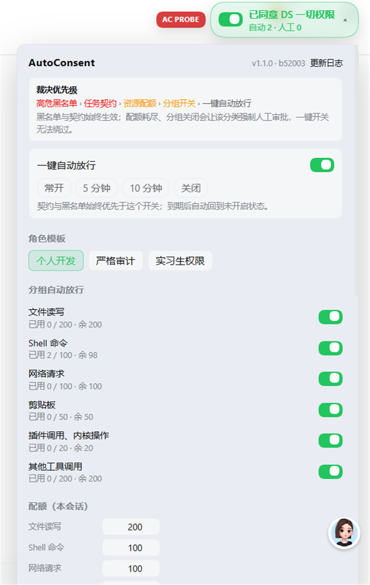

<<<<<<< HEAD
# AutoConsent · dsh-autoconsent

> 任务边界管控版自动审批插件，为 DeepSeek Harness 提供「一键自动放行 + 边界规则」的权限面板。
> 当前版本：**v1.1.0** · 作者：**mzh** · 仓库：<https://github.com/mzh/dsh-autoconsent>

⚠️ **安全警告**：自动放行 Shell、文件写入属于高风险能力，仅建议在本地可信开发环境使用；本插件内置高危黑名单，但仍然建议谨慎使用一键常开模式。



## 功能

> **安装即用**：安装后 Harness 界面右上角会出现 AutoConsent 胶囊按钮与 AC PROBE 探针，
> 点击胶囊即可打开上图控制面板；无需额外配置，宿主与浏览器两半都随本包发布。
> 支持浅色 / 深色主题，面板位置可在 `cordis.patch.yml` 的 `position` 里调整。

### 一键自动放行
胶囊按钮点一下即可让 DSH 的审批请求全部自动通过，再点一下恢复原生确认。
支持 **常开 / 5 分钟 / 10 分钟 / 关闭** 四档，限时模式在悬浮条上实时倒计时。

### 裁决优先级
所有规则按固定优先级执行，面板顶部有明示：

```
高危黑名单 › 任务契约 › 资源配额 › 分组开关 › 一键自动放行总开关
```

- **高危黑名单**：内置 29 条命令（`rm`、`sudo`、`dd`、`chmod 777`、`format c:`、`Remove-Item -Recurse -Force`、
  `git push --force` 等），词边界匹配，命中直接拒绝并记入告警；始终生效，无视开关。
- **任务契约**：绑定本次任务的允许范围，越界写入/命令直接拦截。
- **资源配额**：文件 / Shell / 网络 / 剪贴板 / 插件 / 其他六类独立额度，**按会话隔离**，新会话自动重置；
  额度耗尽后该分类强制回落人工审批。支持【补充配额】与【清零重置】。
- **分组开关**：逐类决定是否允许自动放行；总开关关闭时整组置灰。
- **一键自动放行**：以上规则全部通过后才轮到这里。

### 其他能力
- **角色模板**：个人开发 / 严格审计 / 实习生权限，切换前悬停即可预览规则。
- **影子快照**：自动放行的 `write`/`edit` 保留前像与行级 diff，可逐条一键回滚；不依赖 Git。
- **在场降权**：检测到你在操作电脑时，Shell / 插件类动作改人工确认。
- **自述与动作校验**：Agent 说只读却要写入时直接拦截。
- **子 Agent 隔离**：父会话放行不会外溢到子 Agent。
- **审计证据包**：每条裁决带哈希链，可一键导出 JSON。
- **AC PROBE**：右上角探针显示监听状态（红=监听中 / 灰=自动放行关闭），可隐藏。
- **快捷键**：`Ctrl+Shift+A` 一键开 / 关。

## 安装

在 DeepSeek Harness 中安装本插件包：

```text
plugin_manager install_bundle(target: <本包目录或市场包名>)
```

安装后插件默认启用（`autoEnable: true`），配置写入
`~/.dsh/storages/auto-consent/settings.json`，重启后恢复。

### 配置项（`cordis.patch.yml`）

| 字段 | 默认 | 说明 |
|---|---|---|
| `autoEnable` | `true` | 加载即开启一键自动放行 |
| `template` | `solo` | solo / audit / intern |
| `subagentPolicy` | `isolate` | inherit / isolate / deny |
| `presenceEnabled` | `false` | 在场降权 |
| `presenceWindowMs` | `90000` | 无输入多久算离开 |
| `presenceRisk` | `[shell, plugin]` | 在场时需人工确认的分类 |
| `planCheck` | `false` | 自述与动作校验 |
| `resetEachTurn` | `true` | 每轮重置配额 |
| `snapshots` | `true` | 影子快照 |
| `showProbe` | `true` | 显示探针 |
| `repoUrl` | 本仓库地址 | 面板「更新日志」跳转 |
| `pollSeconds` | `3` | 面板同步间隔 |
| `position` | `{top: 50, right: 14}` | 胶囊位置 |

## 权限风险提示

1. 开启自动放行后，Agent 不再逐条征求同意，**包括删除文件、执行命令、访问网络**。请只在可信项目与本地开发环境中使用。
2. 高危黑名单只能拦住已知的危险命令，无法覆盖一切破坏性操作；契约与配额只是降低风险，不构成安全边界。
3. 关闭总开关、删除插件或重启 Harness 都会立即失效自动放行；建议在无人值守场景配合「限时模式」使用。
4. 插件仅在本机运行，不上传任何数据；审计日志与配置保存在本地 `~/.dsh` 下。

## 版本

- **v1.1.0**：裁决优先级明示；高危 Shell 黑名单扩充 + 词边界匹配；配额按钮拆分；审批日志独立面板；
  悬浮条倒计时与配额告警；AC PROBE 三态与显示开关；分类文案调整；配置导入导出与快捷键。
- v1.0.0：一键自动放行、角色模板、分组开关、配额、契约、影子快照、审计包。

## 许可证

[MIT](./LICENSE) © mzh
=======
# dsh-autocontest

#### 介绍
DSH自动审批插件，带可视化面板，自动放行Shell、文件权限审批

#### 软件架构
软件架构说明


#### 安装教程

1.  xxxx
2.  xxxx
3.  xxxx

#### 使用说明

1.  xxxx
2.  xxxx
3.  xxxx

#### 参与贡献

1.  Fork 本仓库
2.  新建 Feat_xxx 分支
3.  提交代码
4.  新建 Pull Request


#### 特技

1.  使用 Readme\_XXX.md 来支持不同的语言，例如 Readme\_en.md, Readme\_zh.md
2.  Gitee 官方博客 [blog.gitee.com](https://blog.gitee.com)
3.  你可以 [https://gitee.com/explore](https://gitee.com/explore) 这个地址来了解 Gitee 上的优秀开源项目
4.  [GVP](https://gitee.com/gvp) 全称是 Gitee 最有价值开源项目，是综合评定出的优秀开源项目
5.  Gitee 官方提供的使用手册 [https://gitee.com/help](https://gitee.com/help)
6.  Gitee 封面人物是一档用来展示 Gitee 会员风采的栏目 [https://gitee.com/gitee-stars/](https://gitee.com/gitee-stars/)
>>>>>>> 9708cd870bc080d0685dfd12a8ca15b7b36e5874
